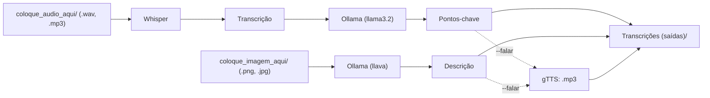

# Transcrição de Áudio com Whisper e Pontos-Chave com Ollama

## Descrição
Pipeline 100% local que recebe áudios (`.wav`/`.mp3`), transcreve com **Whisper** e envia o texto ao **Ollama**, que devolve um resumo com os **pontos-chave**.

Melhorias opcionais implementadas:
- **Descrição de imagens** com modelo multimodal (`llava`).
- **Saída em áudio** (`.mp3`) do resumo/descrição com gTTS (opção `--falar`).



## Estrutura do projeto
```
main.py                      # código da aplicação
executar_audio.bat           # executa o fluxo de áudio (Windows)
executar_imagem.bat          # executa o fluxo de imagem (Windows)
requirements.txt
coloque_audio_aqui/          # ENTRADA: áudios .wav/.mp3
coloque_imagem_aqui/         # ENTRADA: imagens .jpg/.jpeg/.png
Transcrições (saídas)/       # SAÍDA: transcrições, pontos-chave, descrições e áudios
conversor de audio ogg para mp3/   # scripts .bat auxiliares para converter .ogg/.m4a em .mp3
```

## Pré-requisitos
- Python 3.9+ (testado com 3.11)
- [ffmpeg](https://ffmpeg.org/) no PATH (Windows: `winget install ffmpeg`)
- [Ollama](https://ollama.com/) instalado e em execução
- Internet apenas para baixar os modelos e para a opção `--falar` (gTTS)

## Instalação
```bash
python -m venv venv
venv\Scripts\activate        # Linux/Mac: source venv/bin/activate
pip install -r requirements.txt
ollama pull llama3.2         # modelo de texto (resumo)
ollama pull llava            # modelo de imagem (opcional)
```
O modelo do Whisper (`base`) é baixado automaticamente na primeira execução.

## Execução

### Pelos executores (Windows)
1. Coloque os áudios em `coloque_audio_aqui/` e dê dois cliques em **`executar_audio.bat`**.
2. Coloque as imagens em `coloque_imagem_aqui/` e dê dois cliques em **`executar_imagem.bat`**.
3. Os resultados aparecem em `Transcrições (saídas)/`.

Os `.bat` aceitam as mesmas opções do `main.py`, por exemplo `executar_audio.bat --falar`.

### Pela linha de comando
```bash
# Processa todos os áudios da pasta coloque_audio_aqui/
python main.py audio

# Um arquivo específico
python main.py audio coloque_audio_aqui/meu_audio.mp3

# Escolhendo os modelos (Whisper maior = mais preciso; útil para músicas)
python main.py audio --whisper small --modelo llama3.2

# Também gera o resumo em áudio
python main.py audio --falar

# Descreve todas as imagens da pasta coloque_imagem_aqui/
python main.py imagem
python main.py imagem foto.png --falar
```

| Opção | Aplica-se a | Descrição |
|---|---|---|
| `--whisper` | `audio` | Modelo Whisper: `tiny`, `base` (padrão), `small`, `medium`, `large` |
| `--modelo` | `audio` | Modelo de texto do Ollama (padrão `llama3.2`) |
| `--falar` | `audio`, `imagem` | Converte o resultado em áudio `.mp3` |

> Para arquivos `.ogg`/`.m4a`, converta antes para `.mp3` com os scripts da pasta `conversor de audio ogg para mp3/`.

## Exemplo de uso
```
$ python main.py audio
1 áudio(s) a processar.

##### meu_audio.mp3 #####
[1/2] Carregando Whisper 'base' e transcrevendo...

=== TRANSCRIÇÃO ===
Hoje vamos falar sobre modelos open source...

[2/2] Gerando pontos-chave com Ollama (llama3.2)...

=== PONTOS-CHAVE ===
Resumo: ...
*   Modelos open source rodam localmente
*   ...
```

Arquivos gerados em `Transcrições (saídas)/` para cada áudio `<nome>`:
- `transcricao_<nome>.txt`
- `pontos_chave_<nome>.txt`
- `saida_<nome>.mp3` (com `--falar`)

Para cada imagem: `descricao_<nome>.txt` (e `saida_<nome>.mp3` com `--falar`).

## Estrutura do código (`main.py`)
| Função | Responsabilidade |
|---|---|
| `validar_arquivo` | Valida existência e extensão |
| `listar_arquivos` / `listar_audios` / `listar_imagens` | Lê os arquivos das pastas de entrada |
| `transcrever_audio` | **Passo 1** – Whisper: áudio → texto |
| `montar_prompt_pontos_chave` | Prompt template do resumo |
| `extrair_pontos_chave` | **Passo 2** – Ollama: texto → pontos-chave (contexto de 8192 tokens) |
| `descrever_imagem` | Opcional – Ollama multimodal: imagem → descrição |
| `falar_texto` | Opcional – gTTS: texto → `.mp3` |
| `salvar_texto` | Grava os resultados na pasta de saídas |
| `processar_audio` / `fluxo_audio` / `fluxo_imagem` | Orquestram cada pipeline |
| `main` | CLI com `argparse` (subcomandos `audio` e `imagem`) |

## Limitações
- O Whisper está configurado para português (`language="pt"`).
- Transcrições muito longas (acima de ~4 mil palavras) excedem o contexto do LLM e têm o início cortado.
- A opção `--falar` precisa de internet.
